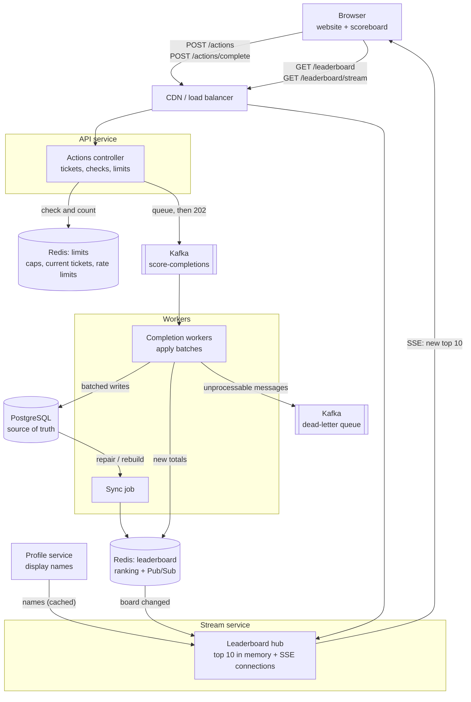
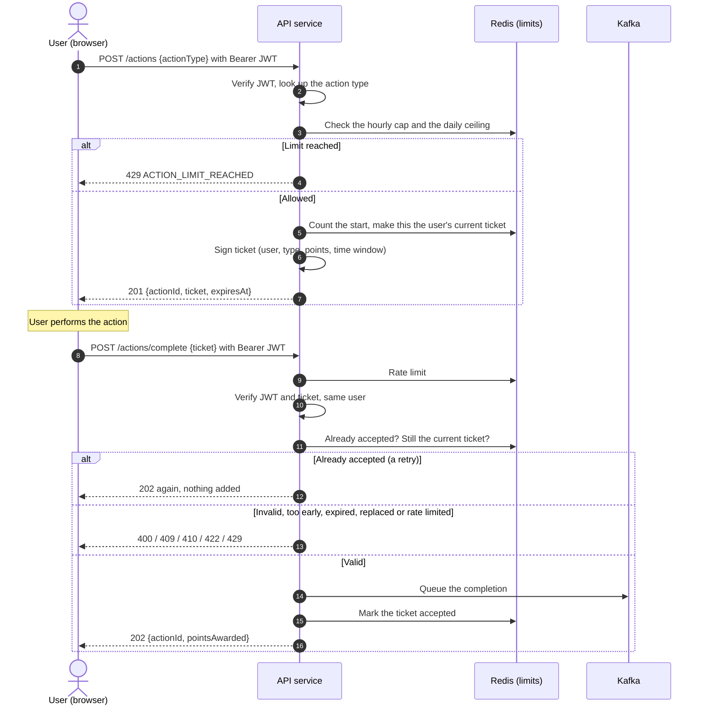
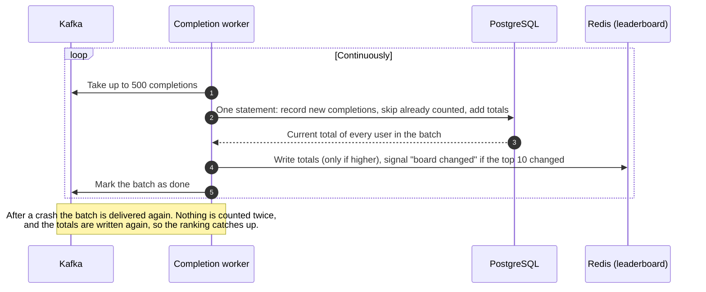
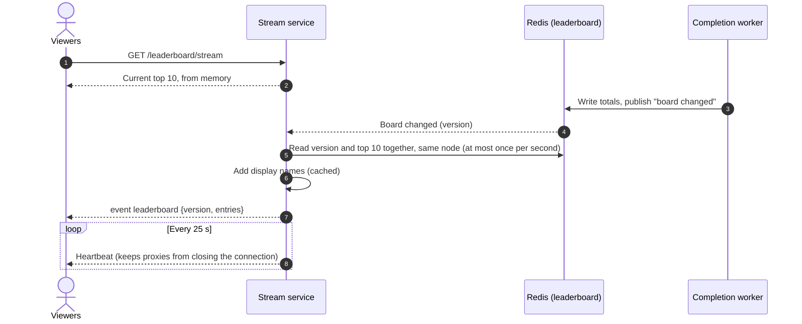
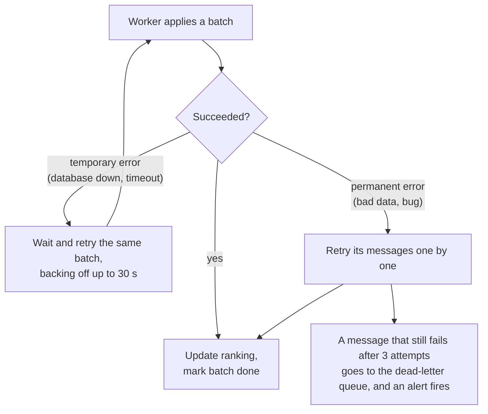

# Problem 6: Scoreboard Module — API Service Specification

|              |                                                  |
| ------------ | ------------------------------------------------ |
| **Module**   | `scoreboard`, part of the API application server |
| **Audience** | Backend engineering team                         |
| **Status**   | Ready for implementation                         |

## 1. Overview

The website shows a **live top-10 scoreboard**. A user completes an _action_ on the website (what the action is doesn't matter here). When it completes, the client calls the API, and the user's score increases.

### Requirements and how this design meets them

| #   | Requirement                                     | How                                                                                                                             |
| --- | ----------------------------------------------- | ------------------------------------------------------------------------------------------------------------------------------- |
| 1   | A scoreboard showing the top 10 users           | Users are ranked in a Redis sorted set. The top 10 is served from memory and cached by the CDN (§5.3).                          |
| 2   | Live updates of the scoreboard                  | Server-Sent Events push the new top 10 to every open board within about a second of a change (§3.3, §5.4).                      |
| 3   | Completing an action increases the user's score | The server decides the points. Every accepted completion is counted **exactly once**, even across retries and crashes (§5.2).   |
| 4   | The completion dispatches an API call           | `POST /actions/complete`, with a ticket obtained when the action started (§4.3).                                                |
| 5   | Prevent unauthorised score increases            | Authenticated calls, signed single-use tickets with the points inside, a minimum duration, one action at a time, and caps (§7). |

### Design principles

- **The server decides points.** Clients never say how many points to add.
- **Never lose or double-count a completion.** Retries, duplicates and crashes are all safe.
- **Bursts cause delay, not failure.** If a million users finish an action at once, the board updates a little later. Requests never wait on the database, and no accepted point is lost.
- **One source of truth.** PostgreSQL holds every score. Everything else (the ranking, the live snapshot) can be rebuilt from it.

### Out of scope

- Sign-up and login. The module trusts JWTs from the existing auth service, and reads display names from the profile service.
- What each action is. The module works the same for every action type.

### Assumptions

- An existing auth service issues JWTs. A profile service provides public display names.
- The action happens in the client, and the client calls the API when it completes (requirement 4).
- Each action type is worth a fixed number of points, configured on the server. Scores only ever go up; corrections are an admin matter (§9).
- The scoreboard is **global and all-time**: one top 10 for everyone, with no seasons or regions.
- "Live" means a change reaches open boards within about **1 second**.
- **Design scale:** up to about 10 million users, bursts of 1 million completions within a minute, and 1 million open scoreboards. These numbers drive the design, and must be confirmed with a load test.
- PostgreSQL, Redis and Kafka are available. Equivalent tools (another SQL database, queue or cache) work the same way.

### Open questions for product

Each has a default in this spec, so the team isn't blocked:

| Question                                          | Default in this spec                           |
| ------------------------------------------------- | ---------------------------------------------- |
| Points, minimum duration and caps per action type | Example values in §4.2                         |
| Daily points ceiling per user                     | 1,000                                          |
| When does "daily" reset?                          | 00:00 UTC                                      |
| Is a maximum score of about 2 million enough?     | Yes (§5.3)                                     |
| How are ties broken?                              | Whoever reached the score first ranks higher   |
| Do board positions win prizes?                    | No. If they do, pay out only after review (§9) |

## 2. Architecture



| Component               | Responsibility                                                                                                                                    |
| ----------------------- | ------------------------------------------------------------------------------------------------------------------------------------------------- |
| **API service**         | Starts actions and issues tickets right away (no queue). Validates completions and puts the accepted ones into Kafka. Doesn't touch the database. |
| **Kafka**               | Durable buffer between accepting a completion and applying it. Keyed by user id, so each user's completions stay in order.                        |
| **Completion workers**  | Apply completions to PostgreSQL in batches, then update the ranking.                                                                              |
| **PostgreSQL**          | The source of truth: every counted completion, and each user's total.                                                                             |
| **Redis (leaderboard)** | The ranking, plus a "board changed" signal over Pub/Sub. Derived from PostgreSQL, so it can always be rebuilt.                                    |
| **Redis (limits)**      | Caps, rate limits and each user's current ticket. Kept apart, so a flood of requests can't slow the board down.                                   |
| **Stream service**      | Keeps the current top 10 in memory and pushes it to every open board. Viewers never cause database reads.                                         |
| **Sync job**            | Repairs or rebuilds the ranking from PostgreSQL after a Redis problem.                                                                            |

### Key decisions

| Decision                     | Choice                                                                                   | Why                                                                                                                                                                         |
| ---------------------------- | ---------------------------------------------------------------------------------------- | --------------------------------------------------------------------------------------------------------------------------------------------------------------------------- |
| How is a completion trusted? | A two-step flow: **start** an action to get a signed ticket, then **complete** it        | The server fixes the points and the timing before the user does anything, so they can't be forged.                                                                          |
| How are completions applied? | **Asynchronously**: queue, answer `202`, apply in batches                                | The API never waits on the database. A burst only makes updates slower, and batching multiplies database throughput.                                                        |
| Ranking store                | **Redis sorted set**                                                                     | Updating a score or finding a rank is O(log N), and reading the top 10 is O(log N + 10).                                                                                    |
| Live updates                 | **Server-Sent Events**                                                                   | Updates only flow from server to browser. SSE is plain HTTP, reconnects automatically and passes through proxies easily. WebSocket would add two-way traffic we don't need. |
| Fan-out across servers       | Redis Pub/Sub sends a "board changed" signal; each stream server reads the top 10 itself | A stale snapshot can never overtake a newer one in transit, and the cost doesn't grow with the number of viewers.                                                           |

## 3. Flow of execution

### 3.1 Starting and completing an action



### 3.2 Applying completions



### 3.3 Live scoreboard



## 4. API specification

All endpoints are under `/api/v1` and return JSON. Authenticated endpoints need `Authorization: Bearer <JWT>`. The user id is **always taken from the token**, never from the request.

### 4.1 Endpoints

| Endpoint                  | Auth   | Purpose                                                                                             |
| ------------------------- | ------ | --------------------------------------------------------------------------------------------------- |
| `POST /actions`           | User   | Start an action and receive a signed ticket (§4.2)                                                  |
| `POST /actions/complete`  | User   | Complete the action with its ticket (§4.3)                                                          |
| `GET /me/score`           | User   | The user's own score and rank, the starts left this hour per action type, and the points left today |
| `GET /leaderboard`        | Public | The current top 10. Cached by the CDN for 1 s; also the fallback for clients without SSE            |
| `GET /leaderboard/stream` | Public | Live updates over SSE (§4.4)                                                                        |

### 4.2 Start an action

```http
POST /api/v1/actions
Idempotency-Key: 6f1c2a9e-…
{ "actionType": "daily_quiz" }

201 Created
{ "actionId": "01930b7e-…", "ticket": "eyJhbGciOi…", "expiresAt": "2026-10-29T10:15:00Z" }
```

Action types are configured on the server, for example:

| `actionType`  | Points | Minimum duration | Expires after | Max per hour |
| ------------- | ------ | ---------------- | ------------- | ------------ |
| `daily_quiz`  | 50     | 30 s             | 15 min        | 5            |
| `watch_video` | 10     | 60 s             | 30 min        | 20           |

Every action type's expiry is **at least 10 minutes**, which leaves room to retry through a short outage (§8.3).

Each user also has a **daily points ceiling** across all action types (e.g. 1,000), set at what an exceptionally active person could earn.

**Windows:**

- "Per hour" is a **rolling 60 minutes**, so there's no burst at the top of the hour.
- The daily ceiling resets at **00:00 UTC**: simple, and the same for everyone. Resetting at each user's local midnight is possible, but adds complexity.

The server checks the hourly cap and the daily ceiling (`429 ACTION_LIMIT_REACHED`). Limits are checked at the start, so a user is never told after doing the action that it won't count. Then it counts the start and reserves its points. The new ticket becomes the user's **current ticket** for that action type, replacing any earlier one, and the server signs and returns it. Every start counts, even if the action is abandoned, so starting many actions at once gains nothing.

**Retrying a start is safe.** The app sends a new `Idempotency-Key` for each start it makes. A retry with the same key, say after the response was lost, returns **the same ticket** and is counted once, so a network glitch never costs the user a start. The server keeps the key until the ticket expires.

### 4.3 Complete an action

```http
POST /api/v1/actions/complete
{ "ticket": "eyJhbGciOi…" }

202 Accepted
{ "actionId": "01930b7e-…", "pointsAwarded": 50 }
```

The API checks, in order, without touching the database:

1. The request is within the rate limit (`429 RATE_LIMITED`). This is checked first, so a flood costs as little as possible.
2. The body contains only the ticket. A client trying to send points gets `400 VALIDATION_ERROR`.
3. The ticket is genuine, unmodified and belongs to the caller (`400 INVALID_TICKET`).
4. **If this ticket was already accepted, the answer is `202` again**, and nothing is added. This check comes before the two below, so a retry of an accepted completion never gets `409` or `410` just because the user has since started another action or the ticket has expired.
5. The minimum duration has passed (`422 ACTION_TOO_EARLY`), and the ticket hasn't expired (`410 ACTION_EXPIRED`).
6. It's still the user's current ticket for that action type (`409 ACTION_SUPERSEDED`).

The API then queues the completion, marks the ticket as accepted, and answers `202 Accepted`. **`202` means the completion will be counted exactly once**, usually within a second, so the client can show "+50" straight away. Until the worker applies it, `GET /me/score` may still return the old score. The app shows whichever is higher, its own optimistic score or the server's, so the "+50" never seems to vanish.

Sending the same ticket again returns `202` again but adds nothing. Even without the accepted marker, for example if the limits store lost it, the database counts each action once (§5.2). On a timeout or `503`, the client retries the **same ticket** with backoff until it expires.

**Client behaviour in real conditions:**

- **Flaky mobile networks:** the app stores the completion and keeps retrying until the ticket expires, so a short loss of signal costs nothing. Set each action type's expiry with that margin in mind. Counting actions completed fully offline would need a different design.
- **The same user on two devices:** starting an action on one device replaces the ticket on the other, so finishing there gets `409`. That's deliberate: it's what stops parallel farming. The app should say "this action was continued on another device", not show an error.

### 4.4 Live updates

`GET /leaderboard/stream` is a Server-Sent Events stream:

```
event: leaderboard
id: 18234
data: {"version":18234,"entries":[{"rank":1,"userId":"u_9","displayName":"alice","score":9800}, …]}
```

- On connect, the current top 10 is sent immediately. After that, it's sent again whenever it changes, **at most once per second**.
- Each update carries the full top 10. Clients keep the one with the highest version, so a reconnect or an out-of-order event can never show an older board.
- The board shows display names and public user ids only.
- Each connection gets a **random reconnect delay** (1–5 s), and stream servers are deployed gradually. That way, a restart doesn't send all of a server's viewers back at the same instant.

### 4.5 Errors

Every error has the form `{ "error": { "code": "...", "message": "..." } }`.

| HTTP | Code                   | When                                                                          |
| ---- | ---------------------- | ----------------------------------------------------------------------------- |
| 400  | `VALIDATION_ERROR`     | Malformed or unexpected body, or an unknown action type                       |
| 400  | `INVALID_TICKET`       | Forged, edited or unreadable ticket, or one belonging to another user         |
| 401  | `UNAUTHENTICATED`      | Missing, invalid or expired JWT                                               |
| 409  | `ACTION_SUPERSEDED`    | A newer action of the same type was started; only the latest can be completed |
| 410  | `ACTION_EXPIRED`       | Completed after the ticket expired                                            |
| 422  | `ACTION_TOO_EARLY`     | Completed before the minimum duration; the ticket stays usable                |
| 429  | `ACTION_LIMIT_REACHED` | Hourly cap or daily points ceiling reached (when starting)                    |
| 429  | `RATE_LIMITED`         | Too many requests; `Retry-After` is set                                       |
| 503  | `SERVICE_UNAVAILABLE`  | The queue or the limits store is down; `Retry-After` is set                   |

## 5. Score processing

### 5.1 Action tickets

A ticket is a standard signed token (JWS). It carries:

- the action id;
- the user;
- the action type and its points;
- the time window: when it can first be completed, and when it expires.

The client can read it but can't change it. The signing key is used only for tickets and is kept in the secrets manager. To rotate it, new tickets use the new key, while old keys are still accepted until their last tickets expire. The user's **current ticket** for each action type is a small Redis key that each start overwrites.

### 5.2 Counting each completion exactly once

- **Every completion is stored with its action id as a unique key.** A duplicate, whether from a retry, a replay or a redelivery after a crash, is skipped.
- **Workers apply up to 500 completions in one database statement.** The statement records them, adds them to each user's total, and returns every user's current total. That includes users whose completions were already counted, so a batch redelivered after a crash still brings the ranking up to date.
- **The queue is keyed by user**, so one user's completions are processed in order by one worker.
- **A batch is marked done only after** the database and the ranking are updated.
- Workers **wait for a Redis replica to confirm** each ranking write, so a Redis failover can't silently lose it. If Redis is down or doesn't confirm, the worker records that the ranking needs repair, and the sync job fixes it (§8.2).

### 5.3 Ranking and ties

- Each user's ranking value **combines their score and when they reached it**. A higher score always ranks higher. Among equal scores, whoever got there first ranks higher. "When" is when the user acted, not when a worker processed it, so a backlog never reorders users.
- Workers write each user's **total** from PostgreSQL, and the ranking **only accepts a value higher than the one it has**. Retries and out-of-order writes can therefore never double-count or lower a score.
- **Maximum score:** packing the score and the time into one Redis number keeps it exact only up to about **2 million points** (about 134 million if time is kept to the minute). Product should confirm this is enough, and an alert fires at 80% of the limit.

### 5.4 Live updates

- After each batch, the worker checks whether the top 10 changed. If it did, the worker **increases the board version** and publishes a "board changed" signal.
- Each stream server then reads **the version and the top 10 together, in one atomic read from the same Redis node**, at most once per second, and pushes them to its viewers. The worker writes them together, so a stream server can never store an older top 10 under a newer version.
- Display names come from the profile service, cached for 60 s. If it's down, or a user no longer exists, the board keeps the cached name or shows a placeholder. A board update never waits on names.
- Pub/Sub can drop messages, so each stream server also **checks the version every 5 s**.
- If the ranking is rebuilt after Redis data loss, the version restarts from the rebuild time, a value higher than any version issued before. Servers and browsers therefore accept the rebuilt board instead of treating it as old.

## 6. Data model

**PostgreSQL** (the source of truth)

| Table            | Purpose                                               | Key points                                                                                                                    |
| ---------------- | ----------------------------------------------------- | ----------------------------------------------------------------------------------------------------------------------------- |
| `score_events`   | History: one row per counted completion               | Unique on the action id, so each action counts once. Partitioned by month.                                                    |
| `user_scores`    | Current total per user                                | The score, and when it was reached (used for ties).                                                                           |
| `ranking_repair` | A single row: "the ranking needs repair since time T" | Set by a worker that couldn't confirm a ranking write; cleared by the sync job once it has copied the scores changed since T. |

**Redis**

| Store       | Holds                                                                                                                                          |
| ----------- | ---------------------------------------------------------------------------------------------------------------------------------------------- |
| Leaderboard | The ranking (a sorted set), the board version, and the Pub/Sub channel                                                                         |
| Limits      | Cap and daily-ceiling counters, each user's current ticket, idempotency keys for starts, "accepted" markers for completed tickets, rate limits |

## 7. Security

| Threat                                    | Defence                                                                                                   |
| ----------------------------------------- | --------------------------------------------------------------------------------------------------------- |
| Calling the API without logging in        | A JWT is required. The user id comes only from the token.                                                 |
| Raising another user's score              | A ticket names its owner, who must match the token's user.                                                |
| Choosing or editing the points            | The points are inside the signed ticket. Any change breaks the signature, and the body accepts no points. |
| Replaying or double-submitting            | Each action id counts once (§5.2).                                                                        |
| Completing without starting, or instantly | A ticket is required, and it can't be completed before the minimum duration.                              |
| Running many actions in parallel          | Only the user's latest ticket per action type can be completed.                                           |
| A script farming points                   | Caps per action type and the daily ceiling: even a script running all day can't out-earn a real person.   |
| Flooding the API                          | Rate limits per user, and per IP at the edge.                                                             |
| Stolen tokens, cross-site requests        | HTTPS only, short-lived tokens sent in a header (not a cookie), and CORS limited to our origin.           |

**Known limit:** the client reports completions, and the module doesn't know what the action is. So it can't prove an action really happened; a determined bot could still do start, wait, complete. The design makes that **capped** (it can't out-earn a real person) and **slow** (minimum duration, one action at a time). §9 lists how to go further.

## 8. Failure handling

The two data stores fail very differently. **PostgreSQL** holds the truth, but it isn't on the user's path. **Redis** is on the user's path, but it only holds copies and counters.

### 8.1 When PostgreSQL fails (Redis still up)

| What                            | Behaviour                                                                                                                                                                                                                                                             |
| ------------------------------- | --------------------------------------------------------------------------------------------------------------------------------------------------------------------------------------------------------------------------------------------------------------------- |
| Starting and completing actions | **Unaffected.** Starting an action only needs Redis. To accept a completion, the API server only needs Redis and Kafka: it puts the completion into Kafka and answers `202`. Workers write to PostgreSQL later, so while it's down, completions simply wait in Kafka. |
| Live board and `GET /me/score`  | Still served from Redis and memory, but **frozen at the last applied scores**. The client already showed "+50" after the `202`, so users see their points; the board just doesn't move yet.                                                                           |
| Workers                         | Pause and retry the same batch with backoff, without skipping ahead (§8.4).                                                                                                                                                                                           |
| Recovery                        | When PostgreSQL is back, workers drain the backlog at full speed and the board catches up. For example, a backlog of 1 million completions drains in under a minute at 20,000 per second. **Nothing is lost.**                                                        |

**Why the workers don't update Redis directly while PostgreSQL is down:** Redis would then be ahead of the source of truth, and exactly-once counting depends on PostgreSQL recording each action first. A paused board is safer than one that might double-count.

**How the outage is kept short and safe:**

- PostgreSQL runs with a **synchronous standby** in another availability zone. If the primary dies, the standby takes over in about a minute, with no committed data lost.
- Kafka keeps messages for **7 days**, far longer than any realistic outage. An alert fires when the queue lag passes 30 s.
- If PostgreSQL is **slow** rather than down, adding workers makes things worse. So worker autoscaling is capped at what the database can take.
- After a **bad migration or data corruption**, restore from backup to just before the problem, then replay Kafka. Each action still counts once.

### 8.2 When Redis fails (PostgreSQL still up)

Both Redis clusters run with **replicas and automatic failover**, so an outage usually lasts **10–30 seconds**.

**Leaderboard Redis**

| What                 | Behaviour                                                                                                                                                                                                                        |
| -------------------- | -------------------------------------------------------------------------------------------------------------------------------------------------------------------------------------------------------------------------------- |
| Counting completions | **Unaffected.** Workers keep saving to PostgreSQL and record that the ranking needs repair. No data is lost.                                                                                                                     |
| Live board           | Each stream server keeps showing its last snapshot: frozen, not broken. If a stream server starts during the outage, it has no snapshot; the CDN then keeps serving its last good copy of `GET /leaderboard` (`stale-if-error`). |
| `GET /me/score`      | The score is read from a PostgreSQL read replica, and the rank is shown as temporarily unavailable.                                                                                                                              |
| Recovery             | The board updates within about 5 s of Redis returning. The sync job copies the scores that changed during the outage, or rebuilds the whole ranking if Redis lost its data (§5.4).                                               |

**Limits Redis**

| What               | Behaviour                                                                                                                                                                                                                                                                               |
| ------------------ | --------------------------------------------------------------------------------------------------------------------------------------------------------------------------------------------------------------------------------------------------------------------------------------- |
| Starting actions   | `503`, retry shortly. It **fails closed**, because without the counters the caps and the daily ceiling can't be enforced.                                                                                                                                                               |
| Completing actions | Still works, with per-server rate limits; the current-ticket check is skipped. The tickets were issued under the caps, so the damage stays bounded.                                                                                                                                     |
| Data lost          | Counters and current tickets restart from zero, so for the rest of that hour or day, users' limits start over. The limits Redis therefore runs with **persistence** turned on. The remaining risk is rare, one-time and bounded, and the anti-cheat measures in §9 would see any spike. |

**Silent drift.** The repair process only covers failures a worker noticed. A bug or a manual data fix could leave Redis and PostgreSQL disagreeing without anyone knowing. So a **nightly drift check** compares every user's total in Redis with PostgreSQL (reading from a replica). It repairs any difference and raises an alert, because any drift means a bug somewhere.

### 8.3 Other failures

| Failure                         | What users notice                | Recovery                                                                    |
| ------------------------------- | -------------------------------- | --------------------------------------------------------------------------- |
| Kafka down                      | Completions get `503`            | Clients retry the same ticket, which stays valid for at least 10 minutes.   |
| A worker crashes                | Nothing                          | Another worker takes over. Redelivered completions are counted once (§5.2). |
| A stream server crashes         | Viewers reconnect within seconds | Browsers reconnect automatically and receive the current top 10.            |
| Client timeout or double submit | Nothing                          | `202` again, counted once.                                                  |

### 8.4 Retries and the dead-letter queue



- **Temporary errors are retried without limit.** While the database is down, every message would fail, so moving them aside wouldn't help. They simply wait in Kafka.
- **One bad message can't block the rest.** It goes to the dead-letter queue. After the bug is fixed, it's replayed, and that's always safe because each action counts once. The user's later messages are applied in the meantime. That's harmless for completions, because order doesn't change a total. For admin changes it can matter (e.g. hide, then adjust), so the replay procedure checks them.

## 9. Improvements and scaling notes

**Stronger proof that an action happened**

- When an action happens on a backend (e.g. a trade, or a lesson finished on the server), that backend should report the completion itself, server to server, instead of the browser. No client request could then create points.
- For actions that partly run on a server (e.g. a quiz graded by a quiz service), that service can sign the result, and the completion call carries it as proof.

**Abuse prevention at scale**

- Only verified accounts (e.g. phone-verified) can earn points, which makes account farms expensive.
- A real-time risk check (device attestation, many accounts on one device, velocity) asks for a CAPTCHA only when a request looks risky.
- An anti-cheat consumer reads the completion stream and looks for bot patterns. It hides suspects from the public board pending human review: reversible, and it doesn't tell bots what was detected.
- If positions win prizes, pay out only after a review window.

**Admin and privacy**

- An admin tool to adjust scores, hide or unhide users, and erase users. Each change goes through the same queue, keyed by user, so it's applied in order with that user's completions and audited.
- A correction that **lowers** a score is the one write that must bypass "only accept higher values" (§5.3). It must not run at the same time as the sync job, so both take the same lock while writing the ranking.
- Let users opt out of the public board.

**Scaling the database**

- PostgreSQL stays off the hot path: users and viewers are served by Redis, Kafka and memory. Only the workers write, in batches.
- Send every read that isn't a worker write (admin, reports, rebuilds) to **read replicas**, keeping the primary for writes.
- **Shard by user id** only if load tests show one primary can't keep up. It would be straightforward: everything is already keyed by user, and the top 10 comes from Redis, so no query needs to span shards.

**Scaling live updates**

- Each stream server can hold tens of thousands of connections, and they scale out independently. Beyond a few million viewers, consider a managed real-time service or CDN streaming.
- If one Redis shard ever becomes a limit for the ranking, split it across several sorted sets and merge their top 10s when reading.

**Reliability and operations**

- If the board must never freeze, stream servers can read the top 10 from a PostgreSQL read replica while Redis is unreachable. This needs an index on score, which adds work to every score update.
- Run every component across availability zones. Restore and replay from Kafka after a bad deploy. Define service level objectives (e.g. 99.95% availability, board updates within 1 s).
- Metrics and alerts: queue lag, dead-letter queue size, rejections per error code, time from completion to board. Tracing from the API request to the board update.
- Load-test bursts (e.g. 1 million completions in a minute) before launch, and scale up ahead of known events.

**Product**

- Weekly or seasonal boards.
- Push each signed-in user their own rank.
